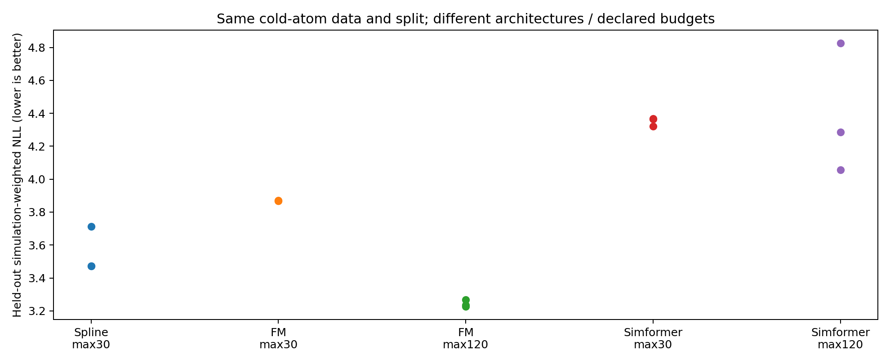
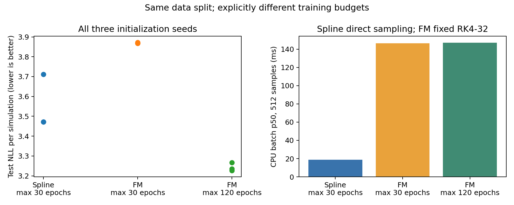

# Cold-Atom Conditional Generative Modeling

Conditional density estimation and sampling for five-dimensional atomic states
`(X, Y, Vx, Vy, Vz)` given nine laser-beam and magnetic-field parameters from
2D magneto-optical-trap (MOT) simulations.

The repository contains the original [`CNF_functions.py`](CNF_functions.py) and a
new [reproducible benchmark](benchmark/) comparing statistical baselines,
conditional spline normalizing flows, conditional Flow Matching, and a
matched-data Simformer adaptation.
The benchmark is a retrospective extension; its measurements are separate from
the original research results.

## Recorded results

All settings use the same simulation-disjoint split, training-only preprocessing,
and equal simulation weighting. Neural results report mean ± sample SD across
initialization seeds **11, 22, 33**, evaluated on **1,872 held-out simulations**.
NLL is measured in the same train-standardized five-dimensional representation;
lower is better.

| Model | Maximum training epochs | Test NLL |
|---|---:|---:|
| Full-covariance Gaussian | Analytic fit | 6.1184 |
| Gaussian mixture | Validation-selected components | 4.8605 |
| Conditional Gaussian MLP | 30 | 5.6596 ± 0.0130 |
| Unconditional spline flow | 30 | 4.6590 ± 0.0228 |
| Conditional spline flow | 30 | 3.5517 ± 0.1381 |
| Conditional Flow Matching | 30 | 3.8695 ± 0.0021 |
| Conditional Flow Matching, extended budget | 120 | **3.2431 ± 0.0212** |
| Simformer cold-atom adaptation | 30 | 4.3517 ± 0.0255 |
| Simformer cold-atom adaptation, extended budget | 120 | 4.3895 ± 0.3940 |

The extended-budget FM setting improves mean NLL by **0.3086 nats** relative to
the 30-epoch conditional spline baseline; the paired simulation-bootstrap 95%
interval is **[0.2682, 0.3520]**. The budgets and checkpoint-selection objectives
differ. This is an exploratory comparison, not an equal-budget superiority claim.

At maximum 30 epochs, conditional spline reduces NLL relative to the Simformer
adaptation by **0.8000 nats** (paired 95% interval **[0.7502, 0.8484]**), and FM
by **0.4822 nats** (**[0.4383, 0.5246]**). At maximum 120 epochs, FM reduces NLL
relative to Simformer by **1.1464 nats** (**[1.0921, 1.2059]**).

The Simformer baseline uses the official two-layer, two-head minimal-example
architecture, specialized to the fixed nine-control/five-state likelihood task.
These are standalone alternatives; flows have not been integrated into Simformer.
Different architectures, checkpoint objectives and early stopping limit claims
about each method's best achievable performance. The larger-budget Simformer
setting has substantially greater variation across seeds.

See the [complete Simformer comparison](benchmark/SIMFORMER_COMPARISON_ZH.md)
for actual epochs, numerical checks, configuration and reproduction commands.





The direct spline sampler takes approximately **19–21 ms per 512-sample CPU
batch**, versus approximately **147 ms** for FM with the recorded RK4-32 sampler.
This is offline batch timing, not service latency or a speedup over a simulator.
Lower NLL does not imply superiority on every marginal sample-quality metric.

## Reproduce or sample

```bash
cd benchmark
# Optional CPU-only PyTorch installation before the remaining dependencies:
python -m pip install torch==2.15.0 --index-url https://download.pytorch.org/whl/cpu
python -m pip install -r requirements.txt
python -m unittest discover -s tests -v

# Reproduce the spline/statistical baselines with the original source CSVs:
python run_experiment.py --data-dir /path/to/data/compiled

# Reproduce both FM budgets after regenerating local baseline row-level outputs:
python run_flow_matching.py --data-dir /path/to/data/compiled --extended

# Offline sampling after training or supplying checkpoints separately:
python src/predict.py --model flow_matching --results results \
  --fm-results results_flow_matching_120 --context-json example_context.json \
  --samples 1000 --output fm_samples.csv
```

See [benchmark documentation](benchmark/README.md) for the data contract,
artifact locations and all commands, and the [experiment report](benchmark/docs/EXPERIMENTS.md)
for evaluation details and limitations.

## Data and scope

The audit removes exact repeated atom rows and excludes ambiguous parameter joins.
The retained cohort contains **33,424 records across 12,478 simulations**, about
**13%** of the deduplicated source records. Source CSVs, observed/generated sample
archives, row-level losses and ID manifests are not redistributed. Source hashes,
split seeds and aggregate metrics are included. Model archives are distributed
separately rather than committed to this public repository. The runners
regenerate row-level artifacts locally when supplied with the original data.
Recovering the original batch/run identifiers is necessary to restore excluded
records and independently confirm source provenance.

The existing test cohort was reused for the FM extension, and the extended budget
was added after viewing the 30-epoch results. Further model selection should use
validation data and an independent confirmation set. The old NLL of 3.11 used a
different data pipeline and cannot be compared with this benchmark. The historical
Simformer evidence covers a toy example; the new cold-atom adaptation is a separate
retrospective experiment.

## Implementation and references

- Conditional spline flow: 8 rational-quadratic spline coupling blocks and LU
  linear permutations, implemented with PyTorch and `normflows`.
- Flow Matching: independent noise/data pairing, linear interpolation, a conditional
  velocity MLP, and numerical ODE sampling. Likelihood uses a reverse ODE with
  exact five-dimensional spatial divergence and numerical-convergence checks.
- Simformer: official minimal-example JAX/Haiku backbone with conditional VE
  score matching and probability-flow likelihood. Upstream source provenance and
  MIT license are included in `benchmark/src/vendor_simformer/`.
- Tests cover ambiguous-key exclusion, group balancing, sampling consistency and
  analytically solvable translation/scaling ODEs.
- [Flow Matching for Generative Modeling](https://arxiv.org/abs/2210.02747).
- [Official Flow Matching ODE/likelihood documentation](https://facebookresearch.github.io/flow_matching/generated/flow_matching.solver.ODESolver.html).

The ODE implementation here is independent PyTorch code, not a call to the
official solver. The original helper file is retained for historical reference;
use `benchmark/src/` for the revised evaluation pipeline.
